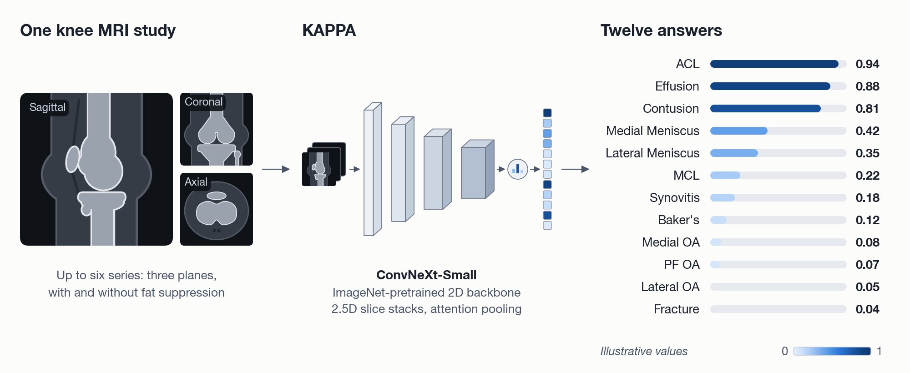
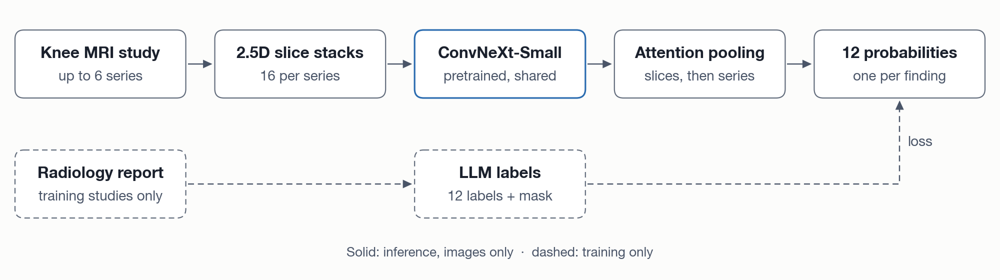
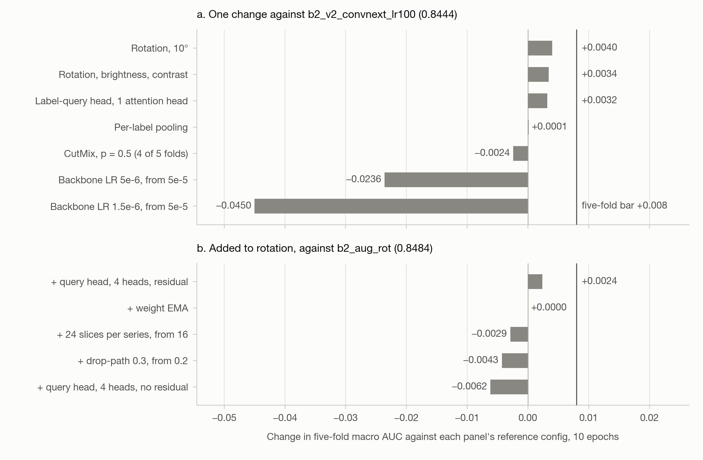

<div align="center">

# KAPPA

**Knee abnormality prediction from MRI with pretrained 2D backbones**

[](https://www.python.org/)
[](https://pytorch.org/)
[](https://github.com/huggingface/pytorch-image-models)
[](https://www.kaggle.com/competitions/rsna-knee-abnormality-detection)
[](https://docs.astral.sh/ruff/)
[](LICENSE)

[How it works](#how-it-works) · [Results](#results) · [Quick start](#quick-start) · [Roadmap](#roadmap) · [Citation](#citation)

</div>

KAPPA reads one knee MRI study and returns 12 probabilities, one for each abnormality the
[RSNA Knee Abnormality Detection](https://www.kaggle.com/competitions/rsna-knee-abnormality-detection)
competition scores: ligament tears, meniscal tears, osteoarthritis, effusion and four more. It
looks at the images only. Radiology reports supervise training but are not available at test
time, so inference runs offline from DICOM alone.

> [!IMPORTANT]
> KAPPA is a research model. It is not a medical device and must not be used for diagnosis.

<p align="center">
  
</p>

<sub>One study in, 12 probabilities out. The knee drawings are schematic and the values are
illustrative.</sub>

## At a glance

| | |
|:--|:--|
| **Input** | One knee MRI study (DICOM), up to six series: axial, coronal and sagittal, each with and without fat saturation |
| **Output** | 12 probabilities: ACL, MCL, medial and lateral meniscus, medial, lateral and patellofemoral OA, effusion, synovitis, Baker's cyst, contusion, fracture |
| **Model** | Pretrained 2D backbone (ConvNeXt-Small) on 2.5D slice stacks, with gated attention pooling |
| **Data** | 4,407 training studies, 24,371 series, 819,635 DICOM files ([dataset reference](docs/dataset.md)) |
| **Labels** | 58 studies labeled by the organizers; the other 4,349 derived from report text |
| **Validation** | 5-fold cross-validation on 3,722 studies, grouped on report text |
| **Metric** | Macro ROC-AUC over the 12 labels |
| **5-fold score** | **0.8508** best single model · **0.8612** seven-model blend |
| **Kaggle score** | **0.850** private · 0.871 public |

## How it works

<p align="center">
  
</p>

1. **Slice.** Each series becomes 16 slices, each stacked with its two neighbours as one
   three-channel image.
2. **Encode.** One pretrained ConvNeXt-Small encodes every slice of every series.
3. **Pool.** Attention pooling combines slices, then series, into 12 probabilities. Missing
   series are masked out.
4. **Supervise.** In training only, an LLM turns each report into 12 labels, plus a mask for
   findings the report leaves open. Test studies have no report, so inference uses images alone.

Five fold models are rank-averaged, and an offline Kaggle notebook writes the submission.
Details: [model reference](docs/model.md).

## Data

KAPPA uses the [RSNA Knee Abnormality Detection](https://www.kaggle.com/competitions/rsna-knee-abnormality-detection)
dataset: 530.7 GiB of DICOM across 4,407 training studies, each with a free-text report written
in one of several languages.

- **Labels:** only 58 training studies carry the 12 labels. KAPPA derives the rest from report
  text; every cross-validation score is measured against those derived labels.
- **Geometry:** volumes are thin and 11.7x anisotropic, and 90.5% of series have inter-slice
  gaps, so KAPPA never resamples to isotropic 3D.
- **Access:** scans and reports are never stored here, and no report text is quoted in this
  repository. Download the data from Kaggle after accepting the competition rules.

## Results

Macro ROC-AUC, 5-fold out-of-fold mean ± sd, seed 0, 8 epochs, 3,722 studies:

| Slots | ConvNeXt-Small | MaxViT-Tiny 384 | DINOv2 ViT-B |
|:--|--:|--:|--:|
| 1 · axial fat-sat | 0.8203 ± 0.0039 | 0.8133 ± 0.0030 | 0.7028 ± 0.0094 |
| **3 · fat-sat axial, coronal, sagittal** | **0.8415 ± 0.0048** | **0.8227 ± 0.0016** | **0.7115 ± 0.0182** |
| 6 · all planes × fat-sat | 0.8347 ± 0.0057 | 0.8231 ± 0.0044 | 0.7004 ± 0.0098 |

<p align="center">
  
</p>

<sub>Single-change experiments at 10 epochs, each against its panel's reference config. The best
single model, 0.8508, adds a residual 4-head query head to rotation.</sub>

- **Three fat-saturated planes beat one axial series on every backbone.** ConvNeXt-Small gains
  +0.0213 on all five folds, mostly from the menisci.
- **Six slots do not beat three.** Adding the non-fat-saturated series costs 0.0068.
- **Blending is the next-largest gain.** Seven models rank-averaged within each fold beat their
  best member on every fold.

<sub>One seed per run. Three seeds on one fold gave sd 0.0060, so a single fold resolves about
0.012 and a five-fold mean about 0.008; smaller differences are not results.</sub>

Full report: [results](docs/results.md).

## Quick start

**Requirements:** Python 3.10. Training needs a CUDA GPU with bf16 support and about 1 TB of free
disk while the archive is extracted. Inference runs in the Kaggle notebook.

```bash
git clone https://github.com/as-obaid/KAPPA.git
cd KAPPA
python -m venv .venv && source .venv/bin/activate
pip install -e '.[data,dev,train]'
make test
cp .env.example .env    # set KAPPA_DATA_ROOT (and KAPPA_SCRATCH on a cluster)
```

Reproduce the pipeline. Each step reads and writes under `KAPPA_DATA_ROOT`:

```bash
scripts/get_data.sh                          # Kaggle archive, 530.7 GiB extracted
sbatch slurm/manifest.sbatch                 # one DICOM header per series
python scripts/build_manifest.py --merge
sbatch slurm/extract_reports.sbatch          # LLM report extraction (GPU)
python scripts/derive_labels.py              # findings -> 12 labels + masks
sbatch slurm/cache.sbatch                    # uint8 slice cache, 182 GB
sbatch --array=0-4 slurm/train.sbatch \
    --config configs/v2_fs_three_planes_convnext.yaml --select best
python scripts/predict.py --out submission.csv \
    --checkpoint data/runs/v2_fs_three_planes_convnext/fold0_seed0.pt \
    --manifest data/interim/manifest_test.parquet --cache-dir data/processed/cache_test
```

Every Slurm job wraps a script in `scripts/` that also runs standalone. [slurm/README.md](slurm/README.md)
lists the variables the jobs expect.

## Repository structure

```text
configs/          one YAML file per experiment
data/folds/       the committed 5-fold split; no scans or reports
docs/             dataset and model references, results report, figures
notebooks/        exploration and the offline Kaggle submission notebook
scripts/          entry points: data build, labels, train, predict, blend
slurm/            batch jobs for data preparation and training
src/kappa/
  data/           DICOM decoding, manifest, slice cache, folds, dataset
  labels/         report findings -> 12 labels and masks (training only)
  models/         slice encoder, attention pooling, study classifier
  training/       training loop, asymmetric loss, weight averaging
  inference/      offline image-only scoring and submission writer
  ensemble/       per-column rank fusion
  evaluation/     metrics and label audit
tests/            pytest suite
```

## Roadmap

The competition has closed; new ideas are scored out of fold and by Kaggle late submission.
Label quality is the main limit: the derived labels agree with the 58 labeled studies at only
0.765, so label work comes first. Each idea is screened on one fold at low resolution before it
earns five folds.

- [x] Series map, slice cache and a report-grouped 5-fold split
- [x] Labels from multilingual report text, checked against the 58 labeled studies
- [x] Slot × backbone sweep, single-change experiments and rank blending
- [x] Offline Kaggle submission: 0.850 private
- [ ] Score the finished MaxViT, 3D, ConvNeXt V2 and distillation runs
- [ ] Soft, calibrated labels, judged on the 58 studies by AUC, log loss and confident errors
- [ ] Validate against the strongest label set and confirm with late submissions
- [ ] Fixed physical field of view, per-series percentile window, left knees mirrored to right
- [ ] Per-series, single-slice baseline: the key ablation of the 2.5D, study-level design
- [ ] Report-embedding auxiliary head, used in training only
- [ ] Short warmup, constant learning rate and weight EMA
- [ ] Anatomy boxes per finding, a joint-centred crop and box pooling
- [ ] Weights and a model card

## Citation

```bibtex
@software{obaidullah2026kappa,
  author = {Obaidullah, Muhammad},
  title  = {KAPPA: Knee Abnormality Prediction with Pretrained Architectures},
  year   = {2026},
  url    = {https://github.com/as-obaid/KAPPA}
}
```

## License and acknowledgements

- **Code:** MIT ([LICENSE](LICENSE)).
- **Data:** the scans and reports are subject to the competition rules and are not
  redistributed.
- **Weights:** not yet published.

Thanks to RSNA, Kaggle and the dataset's annotators; to the PyTorch and timm teams; and to
Northeastern University Research Computing for the Explorer cluster.

**Author:** Muhammad Obaidullah
