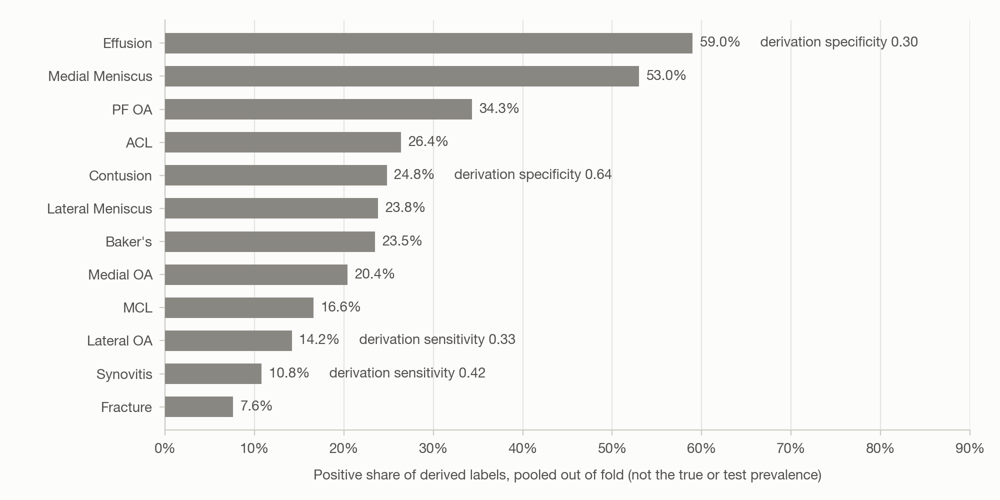

# Dataset

KAPPA is trained and scored on the **RSNA Knee Abnormality Detection** dataset
([Kaggle](https://www.kaggle.com/competitions/rsna-knee-abnormality-detection)). Each study is one
MRI examination of one knee. It holds several series, each a stack of 2D DICOM slices in one plane
with one contrast, and carries 12 binary abnormality labels.

## At a glance

| | |
|:--|:--|
| Training set | 4,407 studies; 24,371 series; 819,635 DICOM files; 569.9 GB |
| Human labels | 58 studies; the other 4,349 are derived from report text |
| Metric | Macro ROC-AUC over the 12 labels |
| Runtime | Kaggle notebook, no internet, 9-hour limit |
| Split | 3,722 development studies in five folds; 685 held out |

## Task and metric

One AUC is computed per label and the 12 are averaged with equal weight, so a rare label counts
as much as a common one. Only the order within a column counts; calibration cannot move the
score. Every training study has a radiology report in one of nine languages. Test studies have
none, so inference is image-only.

## Submission format

One row per test study, with exactly this header:

```
StudyInstanceUID,ACL,MCL,Medial Meniscus,Lateral Meniscus,Medial OA,Lateral OA,PF OA,Effusion,Synovitis,Baker's,Contusion,Fracture
```

`SUBMISSION_COLUMNS` in [`src/kappa/constants.py`](../src/kappa/constants.py) holds the header
and [`tests/test_constants.py`](../tests/test_constants.py) pins it. `Baker's` has an apostrophe
and five labels contain a space, so the header is never built by splitting a string. Values are
per-column ranks scaled to [0, 1].

## Series and slots

`train_series.csv` and `test_series.csv` give each series an `Anatomical_Plane` and two contrast
flags, `Fluid_Sensitive` and `Fat_Suppression`. The two flags agree on every series, so each
series falls into one of six slots:

| Plane | Fat-suppressed | Not fat-suppressed |
|:--|:--|:--|
| Axial | `Axial_fs1`, present in every study | `Axial_fs0` |
| Coronal | `Coronal_fs1` | `Coronal_fs0` |
| Sagittal | `Sagittal_fs1` | `Sagittal_fs0` |

Missing slots are normal; only `Axial_fs1` is present in every study. Fat suppression darkens
marrow so that fluid and oedema stand out. The contrast flag cannot tell proton density from
T2.

## Labels

| Column | Finding | Best planes | Derived rate |
|:--|:--|:--|--:|
| `ACL` | Anterior cruciate ligament tear | Sagittal, coronal | 26.4% |
| `MCL` | Medial collateral ligament injury | Coronal, axial | 16.6% |
| `Medial Meniscus` | Medial meniscal tear or degeneration | Sagittal, coronal | 53.0% |
| `Lateral Meniscus` | Lateral meniscal tear or degeneration | Sagittal, coronal | 23.8% |
| `Medial OA` | Medial tibiofemoral osteoarthritis | Coronal, sagittal | 20.4% |
| `Lateral OA` | Lateral tibiofemoral osteoarthritis | Coronal, sagittal | 14.2% |
| `PF OA` | Patellofemoral osteoarthritis | Axial, sagittal | 34.3% |
| `Effusion` | Joint effusion | Any, fat-suppressed | 59.0% |
| `Synovitis` | Inflamed joint lining | Any, fat-suppressed | 10.8% |
| `Baker's` | Baker's (popliteal) cyst | Axial, sagittal | 23.5% |
| `Contusion` | Bone bruise (marrow oedema) | Any, fat-suppressed | 24.8% |
| `Fracture` | Break in the bone cortex | Any; T1 if acquired | 7.6% |

<p align="center"></p>

<sub>Figure 1. Derived rate per label, pooled out of fold over 3,063 to 3,704 usable studies; not
the true or test prevalence. Annotations mark the weakest derivation figures.</sub>

## Labels from report text

Only 58 training studies carry the 12 labels; 98.7% of raw label cells are empty.
[`scripts/derive_labels.py`](../scripts/derive_labels.py) labels the other 4,349 from their
reports, at training time only:

1. **Extract.** `google/gemma-4-31B-it`, greedy and JSON-schema constrained, lists each finding
   with a verbatim span, an English description, an anatomy string and an assertion: affirmed,
   negated or uncertain.
2. **Map anatomy.** Each anatomy string maps to one or more of 78 clusters. Structures with no
   label, such as the PCL, get their own clusters.
3. **Decide polarity.** Negated is negative and uncertain is masked. Affirmed is resolved from
   the description, because "ACL: preserved" also comes back affirmed.
4. **Map to labels.** Ligament and meniscus labels need only the structure; the rest also need a
   finding-type pattern.

A positive finding beats a negative one, and an unmentioned label reads as negative. Each label
has a `<label>__mask` column: a cell is masked when every finding on it was masked, and a failed
extraction masks the whole row. Masked cells hold 0.0, never NaN, and the loss and AUC skip them.
94.9% of cells are usable.

The derivation agrees with the 58 human-labelled studies at **0.765** macro balanced accuracy
(the mean of sensitivity and specificity; 0.5 is chance). The figure is in-sample, since those
studies guided the derivation. The weakest are `Effusion` specificity 0.30, `Lateral OA`
sensitivity 0.33, `Synovitis` sensitivity 0.42 and `Contusion` specificity 0.64.

## Splits

`data/folds/folds_v2.csv` holds out 685 of the 4,407 studies (15.5%) as a test split. The other
3,722 form five folds.

- **Grouped on report text.** `PatientID` is re-keyed per study, so it groups nothing, and
  identical reports appear under different IDs. Folds group on `report_group`, a hash of the
  normalised report.
- **Stratified** on all 12 labels and report language.
- **Scorable.** [`scripts/build_folds.py`](../scripts/build_folds.py) refuses a split without a
  usable positive for every label in every fold, since such a column has no AUC.

## Sources and access

The data is distributed through Kaggle under the competition rules and is not redistributed
here; [`data/README.md`](../data/README.md) covers the download. No report text is stored in this
repository, and the inference code never imports the label code.
