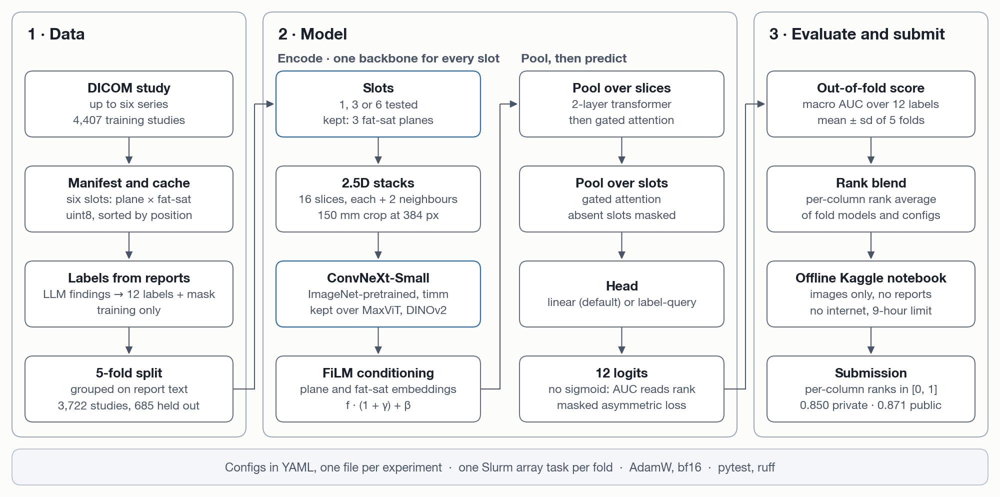

# Model

KAPPA scores one knee MRI study at a time. One shared 2D backbone encodes 2.5D slice stacks from
each series, and gated attention pools the slices into a series vector and the series into a
study vector, from which a head emits 12 logits.

Figure 1. From DICOM study to submission. Blue boxes mark the settings the sweep kept: three
fat-suppressed slots and ConvNeXt-Small.

## At a glance

| | |
|:--|:--|
| Input | Up to six series per study, one per plane × fat-suppression slot |
| Slices | 16 per series, each stacked with its two neighbours as three channels |
| Crop | 150 mm field of view at 384 × 384 px |
| Backbone | `convnext_small`, ImageNet-pretrained, shared across slots |
| Output | 12 logits |
| Parameters | 59,538,158, 83% in the shared encoder |

## Inputs

- **Cache.** Each series is decoded once into an ordered (S, 512, 512) uint8 volume of at most
  64 slices, letterboxed so no slice is stretched. The training cache is 182 GB.
- **Ordering.** Slices are sorted by projecting `ImagePositionPatient` onto the slice normal.
  `InstanceNumber` disagrees with that order in about 41% of series and is never used.
- **Windowing.** Each series is windowed once, at its own 1st and 99th percentiles.
- **No isotropic resampling.** The corpus is 11.7x anisotropic and 90.5% of series have an
  inter-slice gap, so a resampled volume would be mostly interpolation.
- **2.5D stacks.** 16 slice centres sit at equal intervals across the series. Short series
  repeat slices instead of padding with black.
- **Augmentation.** Off by default; rotation, brightness, contrast and CutMix are available.
  Horizontal flip is refused: it swaps medial and lateral, and `MCL` has no lateral column.

## Missing slots

A boolean `present[b, k]` marks whether study b has a series for slot k. An absent slot cannot
change the output:

1. Its pixels are zero-filled and never reach the backbone.
2. The encoder returns exact zeros for it.
3. The pools zero absent rows with `torch.where` before any layer, since `0 · NaN` is NaN.
4. The softmaxes exclude absent positions with `finfo.min`, not `-inf`, which breaks under fp16.

Training drops a slot with probability 0.1 (`series_dropout`), never a study's last, so the model
sees missing slots. A test fills absent slots with NaN and infinite values and asserts a
bit-identical output. Every norm after the backbone is LayerNorm, since BatchNorm would let one
study's zero-filled slot shift another study's output.

## Encoder

`SliceEncoder` wraps one timm backbone shared by all slots, with `drop_path_rate` 0.2 and global
average pooling. **FiLM** conditioning maps each feature to `f · (1 + γ) + β`, where γ and β sum
a plane embedding and a fat-suppression embedding. Factorising them lets a `Sagittal_fs1` sample
train the shared sagittal and fat-suppressed terms, which helps the rarest slots.

## Pooling and heads

`GatedAttentionPool` scores each element with `w · (tanh(Vx) ⊙ sigmoid(Ux))` and takes a masked
softmax. The sigmoid gate can suppress an element, not only reweight it.

- **Series pool.** A learned positional table and a 2-layer pre-norm transformer over the slice
  axis, then gated pooling. Attention never crosses slots.
- **Study pool.** A slot embedding is added, then gated pooling over present slots.
- **Linear head** (default). One linear layer from the 768-d study vector to 12 logits.
- **Query head.** Each label has a learned query that cross-attends all slice tokens.
  `pool.head_residual` adds the pooled study vector, so the pools still receive gradient.

Outputs are logits with no sigmoid, since macro ROC-AUC reads only rank.

| Stage | Shape |
|:--|:--|
| Batch pixels | (B, K, N, 3, H, W) |
| Encoder output | (B, K, N, D) |
| Series pool | (B·K, N, D) → (B·K, D) |
| Study pool | (B, K, D) → (B, D) |
| Logits | (B, 12) |

B studies per batch, K slots (1, 3 or 6), N = 16 slices, H = W = 384, D = 768 for
ConvNeXt-Small.

## Loss and training

- **Loss.** `AsymmetricLoss(gamma_neg=4.0, gamma_pos=0.0, clip=0.05)`, averaged over usable cells
  only. It raises on NaN input, because a zero mask does not remove a NaN.
- **Optimiser.** AdamW with a one-cycle schedule, learning rate 5e-5 for head and backbone, bf16
  mixed precision.
- **Budget.** 8 epochs for the slot × backbone sweep, 10 for later experiments.
  `--select best` keeps the epoch with the best validation macro AUC.
- **Configuration.** Each experiment is one YAML file in [`configs/`](../configs/), validated on
  load; unknown keys fail.

## Inference and blending

- **Offline.** `load_checkpoint` rebuilds the model with `pretrained=False` and reads the
  normalisation saved in the checkpoint, so nothing is downloaded.
- **Image-only.** The inference path never imports `kappa.labels`, and `tests/test_loop.py`
  enforces it.
- **Rank blending.** [`scripts/predict.py`](../scripts/predict.py) blends repeated `--checkpoint`
  arguments by per-column rank normalisation and validates the submission.
  [`scripts/blend_oof.py`](../scripts/blend_oof.py) rank-normalises out-of-fold predictions
  within each fold, since each fold model has its own logit scale.
- **Kaggle.** `notebooks/kaggle_submission.ipynb` is a self-contained copy of the inference path.

## Other encoders

Naming a torchvision video backbone (`r3d_18`, `mc3_18`, `r2plus1d_18`) selects `VolumeEncoder`,
which reads the slice axis as depth. It trails 2.5D by about 0.05.
