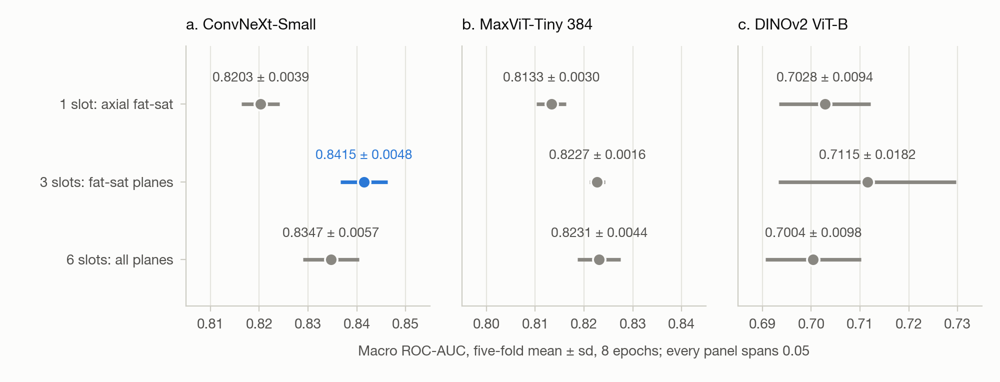
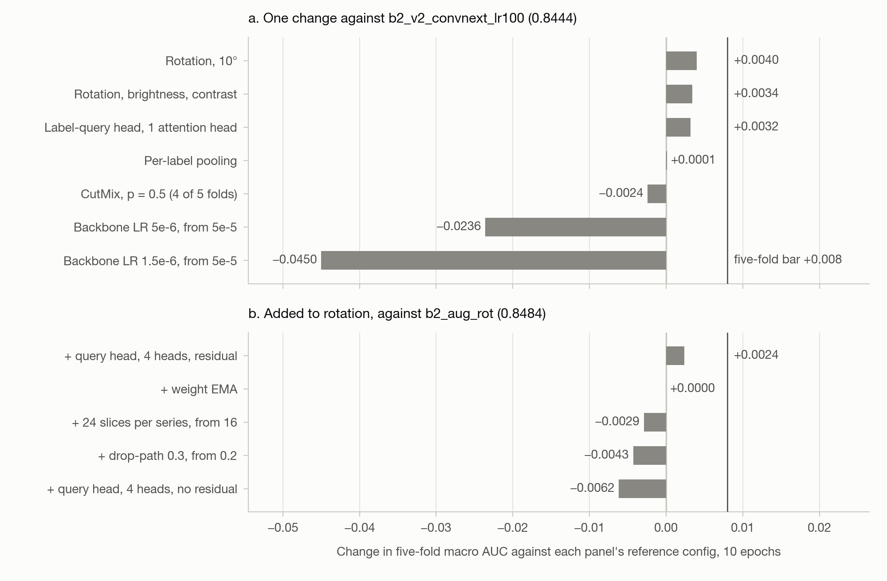
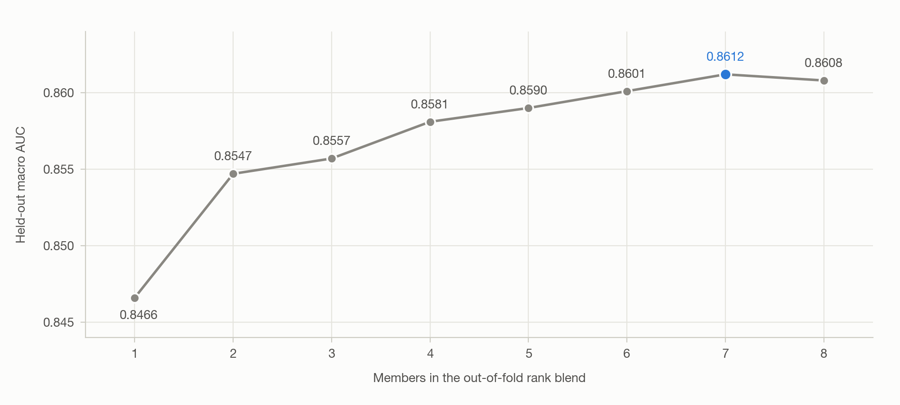

# Results

KAPPA's final submission, a rank blend of ten fold models, scored **0.850** on the private
leaderboard and 0.871 on the public one. In five-fold cross-validation the best single
configuration reaches **0.8508** ± 0.0044 macro ROC-AUC, and a seven-model out-of-fold blend
reaches **0.8612**.

Scores are five-fold out-of-fold macro ROC-AUC, mean ± fold sd, seed 0, unless marked. Configs are
named by their file in [`configs/`](../configs/). See [dataset.md](dataset.md) for the data and
[model.md](model.md) for the model.

## 1 Evaluation protocol

| Item | Rule |
|:--|:--|
| Data | 3,722 development studies in five folds, grouped on report text |
| Held out | 685 studies (15.5%), not yet scored |
| Score | Each study is predicted by the fold model that did not train on it; a config scores the mean of its five per-fold macro AUCs |
| Budget | 8 epochs for the sweep, 10 for single-change experiments; compared within one budget |

**Noise floor.** Three seeds of `v2_fs_three_planes_convnext` on one fold scored 0.8445, 0.8344
and 0.8452, an sd of 0.0060. A single fold therefore resolves about 0.012 and a five-fold mean
about 0.008. A paired fold-by-fold test between two typical configs resolves 0.0027.

## 2 Slot and backbone sweep

| Slots | Configs | convnext_small | maxvit_tiny_tf_384 | DINOv2 ViT-B |
|:--|:--|--:|--:|--:|
| 1, `Axial_fs1` | `v1_axial_fs1_*` | 0.8203 ± 0.0039 | 0.8133 ± 0.0030 | 0.7028 ± 0.0094 |
| **3, fat-suppressed** | `v2_fs_three_planes_*` | **0.8415 ± 0.0048** | 0.8227 ± 0.0016 | 0.7115 ± 0.0182 |
| 6, all slots | `v3_all_slots_*` | 0.8347 ± 0.0057 | 0.8231 ± 0.0044 | 0.7004 ± 0.0098 |

Figure 1. Slot × backbone sweep, five-fold mean ± fold sd at 8 epochs. Every panel spans 0.05
AUC. Source: the table above.

- **Three fat-suppressed planes beat one axial slot on every backbone:** +0.0213 on ConvNeXt,
  +0.0094 on MaxViT and +0.0087 on DINOv2, each on all five folds.
- **The gain is in the menisci.** `Medial Meniscus` rises 0.082 and `Lateral Meniscus` 0.054,
  while nine of the other ten labels move less than 0.03. `Baker's` and `Synovitis` gain nothing.
- **Six slots do not improve on three.** They are lower on ConvNeXt (0 of 5 folds) and DINOv2,
  and level on MaxViT.
- **Per label,** the best config runs from `Baker's` at 0.910 down to `MCL` at 0.783. `Fracture`
  has the fewest positives (7.6%) and the widest error bars.

## 3 Single-change experiments

Each run changes one thing in the three-plane ConvNeXt-Small recipe, at 10 epochs. The
learning-rate runs fix the head at 5e-5 and move only the backbone.

| Config | Backbone LR | Macro AUC | Δ |
|:--|:--|--:|--:|
| **`b2_v2_convnext_lr100`** | **5e-5** | **0.8444** | **control** |
| `b2_v2_convnext_lr10` | 5e-6 | 0.8208 | −0.0236 |
| `b2_v2_convnext_lr03` | 1.5e-6 | 0.7994 | −0.0450 |

Augmentation and head changes, against `b2_v2_convnext_lr100`:

| Config | Change | Macro AUC | Δ |
|:--|:--|--:|--:|
| **`b2_aug_rot`** | **Rotation, 10°** | **0.8484** | **+0.0040** |
| `b2_aug_rotbc` | Rotation, brightness, contrast | 0.8478 | +0.0034 |
| `b3_v2_convnext_query_h1` | Label-query head, 1 attention head | 0.8476 | +0.0032 |
| `b3_v2_convnext_perlabel` | Per-label pooling | 0.8445 | +0.0001 |
| `b2_aug_cutmix` | CutMix, p = 0.5 (4 of 5 folds) | 0.8420 | −0.0024 |

Composition on rotation, against `b2_aug_rot`:

| Config | Change | Macro AUC | Δ |
|:--|:--|--:|--:|
| **`b4_aug_query_h4`** | **Query head, 4 attention heads, residual** | **0.8508** | **+0.0024** |
| `b4_aug_ema` | Weight EMA | 0.8484 | +0.0000 |
| `b4_aug_slices24` | 24 slices per series, from 16 | 0.8455 | −0.0029 |
| `b4_aug_droppath03` | Drop-path 0.3, from 0.2 | 0.8441 | −0.0043 |
| `b4_aug_query_h4_nores` | Query head, 4 attention heads, no residual | 0.8422 | −0.0062 |

Figure 2. Change in five-fold macro AUC at 10 epochs. (a) One change against the control.
(b) Changes added to rotation. The vertical line marks the five-fold bar, +0.008.

- **A slower backbone learning rate is harmful.** Dropping it to 1.5e-6 costs 0.0450, and all
  ten paired folds agree.
- **Most changes are directional.** Rotation and the query head stay under the 0.008 bar.
- **The head residual is a result.** Removing it costs 0.0086 paired (t = 3.70, 95% CI
  [+0.0022, +0.0150]). `b4_aug_query_h4` as a whole gains only +0.0024 over `b2_aug_rot`, under
  the paired bar.
- **The query head beats per-label pooling** by +0.0031 paired (p = 0.024, 95% CI [+0.0007,
  +0.0056]).
- **The epoch budget is saturated.** Going from 8 to 10 epochs gains +0.0029, and from 10 to 14
  (`b4_aug_epochs14`) +0.0002.
- **Other backbones do not help.** CoAtNet (`b3_v2_coatnet384`) scores 0.8387 ± 0.0072, and
  scaling DINOv2-S to DINOv2-B moves macro AUC by +0.0011.

**Volumetric models.** A 3D ResNet-18 over `Axial_fs1` reads D contiguous slices (`3d_ctg_d*`)
or D slices spread over the series (`3d_spn_d*`). One fold only.

| D | 8 | 16 | 24 | 32 |
|:--|--:|--:|--:|--:|
| Contiguous | 0.7629 | 0.7822 | 0.7872 | **0.7906** |
| Spread | 0.7418 | 0.7617 | 0.7812 | **0.7929** |

Depth helps under both samplers, but unlike 2.5D, adding slots hurts: three slots at D = 16
(`3d3_ctg_d16`) score 0.7665. All sit about 0.05 below the three-plane ConvNeXt config.

## 4 Out-of-fold blend

The members are `b2_aug_rot`, `b2_aug_rotbc`, `b3_v2_convnext_query_h1`,
`b3_v2_convnext_perlabel`, `b2_v2_convnext_lr100`, `3d_ctg_d32` and `v3_all_slots_maxvit`. Each is
rank-normalised within each fold, because normalising the pooled table costs a single model
0.0027. Members are averaged with equal weights, since fitted per-label weights add only +0.0013.
[`scripts/blend_oof.py`](../scripts/blend_oof.py) reproduces it.

Figure 3. Held-out macro AUC by number of blend members. Seven give the peak.

- **Every fold gains.** The mean per-fold gain is +0.0125 (SEM 0.0015). Choosing members on four
  folds and scoring the fifth gives the same figure.
- **The blend saturates at seven.** All 22 complete configs give 0.8499, and each DINOv2 member
  costs 0.0027 to 0.0032.
- **Most of the gain is variance averaging.** A ConvNeXt-only search reaches 0.8603, against
  0.8615 for the full pool.

## 5 Leaderboard

The submission rank-averages the five fold models of each of `v2_fs_three_planes_convnext` and
`v3_all_slots_convnext`, run offline in a Kaggle notebook.

| Submission | Public | Private |
|:--|--:|--:|
| Ten-model rank blend | 0.871 | **0.850** |

The private score is the final one. Neither is directly comparable to CV, which scores one model
per study rather than ten, but both landed above the nearest local figure, 0.8448, so local CV is
not optimistic. The public baseline notebook scores 0.809.

## 6 Limitations

| Limit | Effect |
|:--|:--|
| Labels are mostly derived | 4,349 of 4,407 studies are labelled from report text at 0.765 balanced accuracy, measured on the 58 studies that guided the derivation. CV measures agreement with the derivation, not radiologists. |
| Folds are not grouped by scanner | A published header-only probe on this data, not a KAPPA run, scored 0.6516 on random folds and 0.5981 on scanner-grouped folds, so about 0.05 can be scanner recognition. |
| One seed per config | The noise floor rests on three seeds of the noisiest config (95% CI [0.0031, 0.0377]). |
| Best epoch chosen on the scored fold | An unmeasured bias, shared by every config. |
| No held-out score | The 685 held-out studies are unscored; no bootstrap intervals or DeLong tests. |
| Not reported | The remaining MaxViT, 3D, ConvNeXt V2 and distillation configs in `configs/`, and test-time augmentation. |
